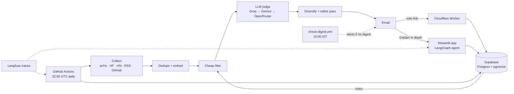

# Research Radar

A personal, daily AI-research digest. Every morning it emails the few items worth my time out of ~100-150 new papers, blog posts, tool releases and fresh GitHub repos, each explained in plain words and tied to the topics I care about. Every item has vote buttons that teach the ranking, and an **Explain in depth** link that opens a grounded, cited chat about it.

It runs entirely on free tiers: GitHub Actions, Supabase, Groq/Gemini/OpenRouter, Cloudflare Workers, Streamlit Community Cloud.

## What it does

1. **Collects** from arXiv, Hugging Face Daily Papers, Hacker News, blog feeds, release feeds of tools I watch, and **new GitHub repos** (created in the last 14 days, already starred, with the start of the README read).
2. **Dedupes** by canonical URL and by embedding similarity, and skips anything sent recently.
3. **Filters** cheaply (topic similarity, keywords, recency, popularity) down to ~30 candidates.
4. **Judges** them with an LLM (relevance, novelty, actionability) and writes each entry for a curious non-expert: what was found, why it matters to me, an "Imagine..." example.
5. **Diversifies** (max 2 per topic, max 2 repos in the top picks, one "something different" slot) and runs an **editor pass** so entries read plainly and don't repeat each other.
6. **Emails** the digest with four buttons per item. A vote is one click and shows a tick; the next ranking can use it.
7. **Explains in depth**: the link opens a Streamlit app that fetches the paper, post or README, indexes it in memory, and answers with cited passages. Follow-ups keep context, and the chat is saved.



## Design choices worth knowing

- **A pipeline, not an agent.** The daily batch is plain Python stages over typed objects; SQL does dedupe and vector search. The one place that needs reasoning, the deep-dive chat, uses LangGraph.
- **The deep dive has no tools to hijack.** Retrieval is done in code; the model only turns numbered source passages into a cited answer. Fetched pages are quoted as untrusted data, fetching blocks private addresses (including through redirects), and answers can only cite passages the model was given.
- **Plain AND specific writing**, measured. Reading grade, jargon rate and entry-to-entry sameness are evaluated from the stored digests, and CI fails if they drift (once enough real digests exist).
- **Degrade, don't die.** A failing source or exhausted model chain produces a degraded digest, not none. A second workflow emails an alert if no digest went out.
- **Idempotent.** A run row is a lock: one real digest per local day, so retries and late cron fires can't double-send. Digests are dated in the reader's timezone, not the runner's.
- **Config over code.** Topics, sources, models (pinned, never "latest"), quotas and thresholds live in [`topics.yaml`](topics.yaml).
- **Every decision is written down** in [`decision.md`](decision.md): problem, choice, why, alternatives, and what went wrong (including a probe that wrote to the database, D-059).

## Evaluation

`radar-eval` replays stored scores against hand labels (no LLM calls) and reports precision@5 for keyword-only, embedding-only, hybrid, LLM-judged and vote-blended rankers, plus judge-vs-label agreement. Labels come from the dashboard's Labeling page.

**Honest status:** the golden set is still being labelled, so the precision table is empty. The writing checks run on real digests only and wait for 15 entries. Run `uv run radar-eval` for the current report ([`evals/reports/latest.md`](evals/reports/latest.md)).

## Setup

You need: Python 3.11+, [`uv`](https://docs.astral.sh/uv/), a free Supabase project, a Groq key (Gemini and OpenRouter keys are fallbacks), and a Gmail app password.

```bash
git clone <this repo> && cd Research_Radar
uv sync --all-groups
cp .env.example .env            # fill in DATABASE_URL, the LLM keys, SMTP_*, EMAIL_*, FEEDBACK_SIGNING_SECRET
uv run radar-smoke              # applies migrations, calls the LLM, sends a test email, writes a trace
uv run radar-run --dry-run --email --top-n 10    # full pipeline, emails you the result, takes no lock
```

Then, to run it for real:

1. **Schedule.** Add the secrets used by [`daily-digest.yml`](.github/workflows/daily-digest.yml) (`DATABASE_URL`, the three LLM keys, `LANGFUSE_*`, `SMTP_*`, `EMAIL_FROM`, `EMAIL_TO`, `FEEDBACK_SIGNING_SECRET`) and the variable `FEEDBACK_BASE_URL` to the repo.
2. **Vote links.** In `worker/`, run `npx wrangler secret put` for each of `FEEDBACK_SIGNING_SECRET`, `SUPABASE_URL` and `SUPABASE_KEY` (the publishable key), then `npx wrangler deploy`, and set `FEEDBACK_BASE_URL` to the Worker's URL.
3. **Deep dive.** Deploy `agent/app.py` on [Streamlit Community Cloud](https://share.streamlit.io) from the repo, put the same secrets in its Secrets box plus `APP_ENV = "production"`, and set `DEEPDIVE_BASE_URL` if your app URL differs from the default.
4. **Dashboard (optional).** `uv run streamlit run dashboard/app.py`; deploy it the same way if you want it public. Give it a SELECT-only database role via `DASHBOARD_DATABASE_URL`.

Make it yours by editing `topics.yaml`: the topics (with a few anchor papers each), sources, GitHub search terms, watched tools, and quotas.

## Commands

```bash
uv run pytest -q                       # tests: no network, no real keys
uv run ruff check . --fix              # lint
uv run radar-run --dry-run --top-n 10  # cheap end-to-end run, no lock, no email
uv run radar-eval                      # offline evals report
uv run radar-check --no-alert          # was a digest sent in the last 10 hours?
uv run radar-maintain --preview        # storage retention: what would be slimmed or deleted
uv run streamlit run dashboard/app.py  # dashboard (Labeling page: local only)
node --test worker/test/handler.test.mjs   # the vote Worker
```

## Layout

```
src/radar/      pipeline: collect/, dedupe, filter, judge, diversify, compose, pipeline, feedback, health, maintain, stats
src/radar/agent/   deep dive: tools (safe fetch), index, graph (LangGraph), store
agent/          Streamlit deep-dive page          dashboard/   Streamlit dashboard
worker/         Cloudflare Worker (vote links)    db/migrations/   versioned SQL
topics.yaml     all behaviour config              tests/       pytest, fakes and fixtures only
```

Deeper docs: [`research-radar.md`](research-radar.md) (architecture and rationale), [`flow.md`](flow.md) (how data flows, stage status), [`plan.md`](plan.md) (phases), [`decision.md`](decision.md) (all decisions).

## Known limits

- Free hosting sleeps: the first Explain-in-depth click after a quiet spell can take about 30 seconds.
- Free LLM tiers rate-limit and change; pinned model IDs are checked weekly in CI and fall back down the chain.
- GitHub's scheduler can start a run hours late; the schedule leaves a buffer and a second job alerts if it is missed.
- Star counts can be inflated, so they only feed a capped popularity term; the judge decides relevance.
