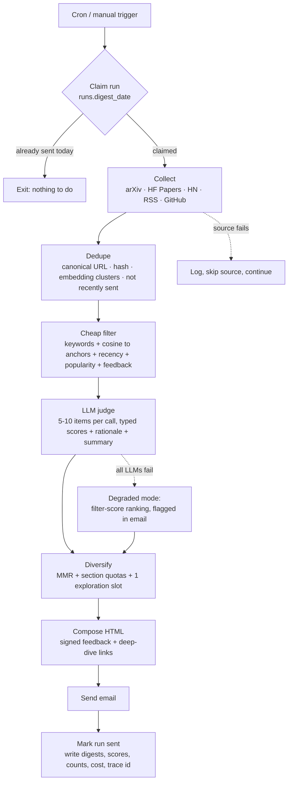
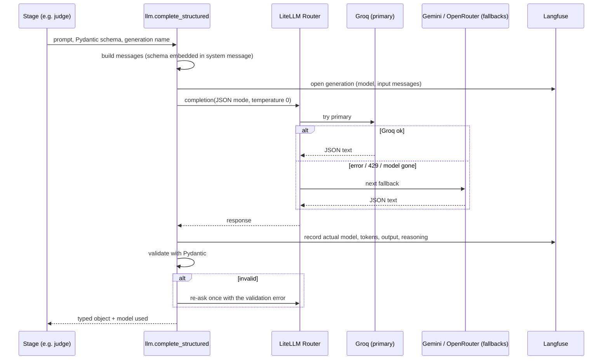
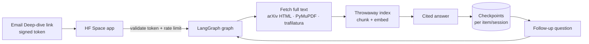
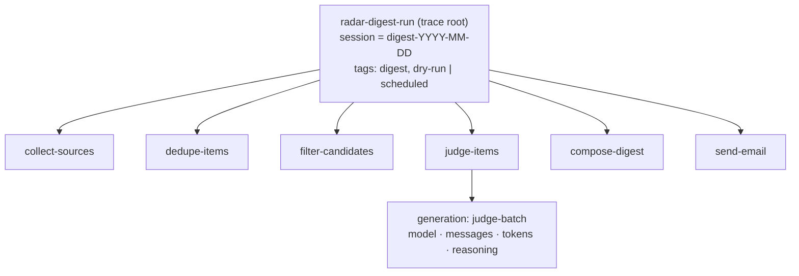
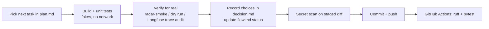

# Flow

How the system works end to end, what runs when, and how far along the build is. Update the status tables as stages are built.

Legend: ✅ built and verified · 🔨 in progress · ⬜ planned

---

## 1. Daily run (the pipeline)

Triggered by GitHub Actions cron (and manually via `workflow_dispatch`).



Typical numbers from a live run: ~410 collected → ~395 unique → ~393 fresh → 33 judged → 8 in the digest (5 core, 2 watchlist, 1 exploration).

Rules that always hold:
- The run row is created first and is the lock. A retry or late duplicate cron cannot send a second digest (partial unique index on non-dry runs).
- A failed source or exhausted LLM chain degrades the digest instead of cancelling it.
- Dry runs (`is_dry_run`) execute everything except sending, and never take the lock.
- The whole run is one Langfuse trace; each stage is a nested span.

### Stage status

| Stage | Module | Status |
|---|---|---|
| Config + secrets | `config.py`, `topics.yaml`, `.env` | ✅ |
| DB + migrations + run lock | `db.py`, `db/migrations/` | ✅ |
| LLM router + structured output | `llm.py` | ✅ |
| Tracing | `tracing.py` | ✅ |
| Email adapter | `deliver/email.py` | ✅ |
| Collect | `collect/` | ✅ |
| Dedupe + embed | `dedupe.py`, `embed.py` | ✅ |
| Cheap filter | `filter.py` | ✅ |
| Judge | `judge.py` | ✅ |
| Diversify | `diversify.py` | ✅ |
| Compose | `compose.py` | ✅ |
| Orchestrator | `pipeline.py` | ✅ |
| Scheduled workflow | `.github/workflows/daily-digest.yml` | ✅ |

---

## 2. One LLM call

Every model call, whatever the stage, goes through `llm.complete_structured`.



---

## 3. Feedback loop

```mermaid
sequenceDiagram
    participant U as Me (email client)
    participant W as Cloudflare Worker
    participant DB as Supabase
    participant P as Next day's pipeline

    U->>W: GET /f/{signed token}
    W-->>U: confirm page (no state change; scanners stop here)
    U->>W: POST /f/{signed token}
    W->>W: verify HMAC, expiry, nonce unused
    W->>DB: upsert feedback (idempotent), mark nonce used
    P->>DB: read feedback for revealed-interest score
    P->>P: rank = stated interests (anchors) blended with revealed interests (kNN)
```

Status: ⬜ (Phase 2)

---

## 4. Deep dive



Safety: read-only tools only; fetched text is untrusted; private-network URLs are blocked. Status: ⬜ (Phase 3)

---

## 5. Tracing flow



Audited against a real run: root `radar-digest-run` → `collect-sources`, `dedupe-items`, `filter-candidates`, `judge-items` (→ one `judge-batch` generation per batch, with model and token usage), `diversify-items`, `compose-digest`, `send-email`. Keep these names stable; dashboards and evaluators will depend on them.

---

## 6. How a change moves through the repo



Environments:
- **Local:** `.env`, dry runs, dev console.
- **GitHub Actions:** secrets from repo settings (set via `gh`), scheduled daily run, CI.
- **Hosted services:** Supabase (data), Langfuse (traces), Groq/Gemini/OpenRouter (LLMs), Gmail SMTP (email); later Cloudflare Worker and Hugging Face Spaces.

---

## 7. Phase map

| Phase | Outcome | Status |
|---|---|---|
| 0 Foundations | LLM, DB, email, tracing, CI, secrets, dev console shell | ✅ |
| 1 Digest MVP | Daily email, labeling started | 🔨 pipeline, workflow, dev console done; 5 unattended mornings pending |
| 2 Feedback + evals | Votes flow back, precision@5 table | ⬜ |
| 3 Deep dive | Cited, follow-up-capable chat per item | ⬜ |
| 4 Polish | Watchlist, dashboard, README, dev console removed | ⬜ |
| 5 Stretch | Optional extras | ⬜ |
