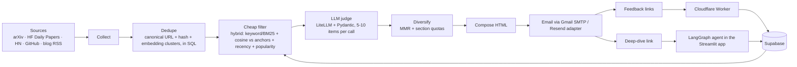

# Research Radar

A personal, daily AI-research digest for GenAI engineers. It collects new papers, posts, repos and releases, filters them against my interests, explains *why each item matters to me*, and learns from my 👍/👎 feedback. Each item has a **Deep dive** link that opens a grounded, citation-backed chat about it.

**Status:** built and running (this is the original design doc; see [README.md](README.md) for the current state and [decision.md](decision.md) for what changed) · **Mode:** solo project · **Goals:** daily-use tool + portfolio piece · **Constraint:** hosted free tiers only (no local GPU)

---

## 1. Decisions locked in

| Decision | Choice |
|---|---|
| Project | Research Radar |
| Delivery | **Email** (HTML digest, 👍/👎 links, Deep-dive link). **Gmail SMTP (app password) first**; Resend later if I get a domain. WhatsApp = possible phase 2 |
| Pipeline | Plain Python stages, orchestrated by `pipeline.py` (no agent framework) |
| Judge | **LiteLLM** + Pydantic schema (`response_format`); Instructor is the fallback if a provider handles structured output badly |
| Deep-dive agent | **LangGraph** (earns its place via checkpointed follow-up chat) |
| LLM access | **LiteLLM** → **Groq free tier (primary)**, fallbacks: Gemini free tier, OpenRouter `:free`. Model versions pinned in config |
| Storage | **Supabase** (Postgres + pgvector). Neon is an equal alternative |
| Scheduling | **GitHub Actions** cron |
| Observability | **Langfuse** |
| Evals | Own golden set, offline ablation and LLM-checked faithfulness (own code, D-040) |
| Feedback endpoint | **Cloudflare Worker** (JS, feedback only) |
| Deep-dive host | **Streamlit app on Streamlit Community Cloud** (Python needed for PyMuPDF/trafilatura; Workers can't run it; Hugging Face now needs PRO for this, D-049) |
| Dashboard | **Streamlit** on Streamlit Community Cloud |

**Design principle:** the daily batch is a *deterministic pipeline*, not an agent. Agents are used only where reasoning is needed (deep-dive chat). Where SQL can do the job (dedupe, vector search, novelty check), use SQL.

**Rule:** one new thing per project. The new thing here is the **eval + feedback-personalization loop**, not an agent framework. PydanticAI was dropped: the judge is one batched structured-output call, and a second abstraction over LiteLLM adds cost without benefit. LangGraph is already familiar.

---

## 2. Topics

Each topic gets a one-sentence description (used as the LLM judge's rubric) **plus 5-10 anchor items** (seed papers/posts I love) used for embedding match. A single description embeds loosely and ranks generic "LLM" content too high; anchors fix that and also give the feedback model a warm start.

1. **Agentic systems and orchestration**: multi-agent patterns, planning, tool use, handoffs, agent reliability, MCP, A2A.
2. **RAG and retrieval**: hybrid search, rerankers, GraphRAG, contextual retrieval, chunking, multimodal retrieval.
3. **LLMOps, evals and observability**: LLM-as-judge, eval frameworks, tracing, cost/latency optimization, prompt caching.
4. **Memory and context engineering**: how agents store, retrieve and compress state across sessions; compaction; memory benchmarks.
5. **Agent security and guardrails**: prompt injection, tool-permission design, sandboxing, guardrail frameworks.
6. **Enterprise GenAI in production**: case studies, architecture write-ups and lessons from teams shipping RAG/agents at scale.

**Plus a Watchlist section:** release feeds for tools I track (LangGraph, LiteLLM, Langfuse, Mem0, etc.), scored against the topics above and shown in their own digest section.

**Excluded on purpose:** generic AI news (funding rounds, CEO drama, model-release hype).

---

## 3. Architecture

```
Collect → Dedupe → Cheap filter → LLM judge → Diversify → Compose → Email
                                                                      │
          ┌───────────────────────────────────────────────────────────┘
          ▼
   👍 / 👎 link ──► Cloudflare Worker (confirm page, POST) ──► Supabase (feedback)
                                                  │
                                    interest score / ranking blend
   Deep dive link ──► Streamlit app (signed token) ──► LangGraph agent ──► grounded answer + citations
```



### Pipeline stages

| Stage | What it does | Tools |
|---|---|---|
| **Collect** | arXiv (cs.CL / cs.AI / cs.IR, **keyword-prefiltered before embedding**, since these categories are huge), HF Daily Papers, HN Algolia API, GitHub Search API (recent, high-star repos), curated blog + release Atom/RSS feeds (Anthropic, OpenAI, LangChain, Simon Willison, Latent Space, Eugene Yan, ...). Tavily is **post-MVP** (small free quota, noisy) | `feedparser`, `httpx` |
| **Dedupe** | Normalize to a canonical URL, content hash, then cluster near-duplicates by embedding similarity (pgvector query) and keep one item per cluster. Also drop anything already sent in the last N days | FastEmbed, SQL |
| **Cheap filter** | Hybrid score: keyword/BM25 boost + cosine to topic anchors + recency + popularity (+ feedback score once available); ~300 items → ~30 | pgvector, SQL |
| **LLM judge** | Score relevance, novelty, actionability, each with a one-line rationale (typed output). **5-10 items per call**, not 30, to limit position bias and truncated output. Topic rubric goes in a stable prompt prefix for caching. Model version pinned | LiteLLM, Pydantic, Groq (Llama-class model with JSON mode) |
| **Diversify** | MMR so the digest isn't five papers on the same thing; per-section quotas | plain Python |
| **Compose + deliver** | 2-line summary + "why it matters to you", generated **only from title + abstract** (no invented claims); HTML email | Gmail SMTP with app password (zero setup); Resend adapter once I own a domain. `deliver/email.py` exposes `send(subject, html, to)`, backend chosen by env var |

### Reliability

- **Idempotent runs:** the `runs` table is the lock. A retry or a late/duplicated cron cannot send a second digest for the same date (unique `digest_date`).
- **Degraded mode:** if a source fails or every LLM fallback is exhausted, still send a digest (embedding-only ranking, marked as such) rather than nothing.
- **Alerting:** a failed or missing run triggers a notification (Actions failure email plus a "no digest by 10am" check).
- **Pinned models:** free-tier models (Groq, Gemini) get deprecated or renamed; model IDs live in config and a smoke test runs in CI.

### Feedback loop

Two interest layers, blended in ranking:
- **Stated interests:** topic descriptions + anchor items (optionally Mem0 later).
- **Revealed interests (v1, simple):** score = similarity to the k nearest 👍/save items minus similarity to the k nearest 👎 items, over **all** votes. At about one vote a day, per-topic centroids are too noisy.
- **Signal strength:** `save` and `deepdive` count as stronger positives than 👍.
- **Per-topic splitting (v2):** only added if the ablation shows it helps, so a miss in one topic doesn't penalize others.

Include **1 exploration slot** per digest (an item slightly outside my usual profile) so the system can discover new interests.

### Email feedback links: gotchas

- Mail scanners (Gmail, corporate security) pre-fetch links and can register phantom votes. So each 👍/👎 link opens a small page with a **confirm button that does a POST**; only the POST counts.
- Links carry an **HMAC-signed token** (item id, run id, action, expiry) with a **nonce** stored server-side so a link can't be replayed.
- Votes are **idempotent per item** (one row, latest vote wins), so a double click doesn't double-count.

### Deep-dive agent (LangGraph)

1. Link opens the Streamlit app; the signed token is validated before anything runs.
2. Agent fetches the full text (arXiv HTML or PyMuPDF for papers; Jina Reader / `trafilatura` for web pages).
3. Builds a throwaway index, answers with citations.
4. Keeps per-item state (an in-memory graph thread plus a saved transcript in Postgres, D-054) so follow-ups like "how does this compare to X?" work. This is the part that justifies LangGraph; the first answer is a plain linear RAG chain.
5. Optional tool: compare against my previously saved items.

**Safety:**
- Fetched content is untrusted (prompt injection). The agent gets **read-only tools only**, no writes, no email, no DB mutation beyond its own checkpoints.
- The public endpoint is gated by the signed token (7-day expiry) and **rate-limited** per item, otherwise anyone with the URL could burn the free quota.
- Community Cloud apps sleep after about 12 idle hours, so the first click can take ~30s. The email says so.

---

## 4. Data model (Supabase / Postgres + pgvector)

Sketch, not final. Key changes from v1: no full text stored in `items`, canonical URL/hash/cluster for dedupe, embedding model version, one score row per item per run, idempotent feedback with run/section context.

```sql
create extension if not exists vector;

create table items (
  id              uuid primary key default gen_random_uuid(),
  canonical_url   text unique not null,
  url             text not null,
  content_hash    text,
  title           text not null,
  source          text not null,          -- arxiv | hf_papers | hn | github | rss | tavily
  published_at    timestamptz,
  snippet         text,                   -- title/abstract only; full text is fetched at deep-dive time
  embedding       vector(384),            -- match your FastEmbed model's dimension
  embedding_model text not null,          -- changing models invalidates vectors; re-embed on change
  cluster_id      uuid,                   -- near-duplicate cluster
  popularity      int default 0,
  created_at      timestamptz default now()
);

create table runs (
  id            uuid primary key default gen_random_uuid(),
  digest_date   date unique not null,     -- idempotency guard: one digest per day
  status        text,                     -- running | sent | degraded | failed
  started_at    timestamptz default now(),
  sent_at       timestamptz,
  n_collected   int, n_filtered int, n_sent int,
  cost_usd      real, notes text
);

create table item_scores (
  item_id       uuid references items(id),
  run_id        uuid references runs(id),
  best_topic    text not null,
  topic_scores  jsonb,                    -- other topics' scores, if any
  relevance     real, novelty real, actionability real,
  rationale     text,
  filter_score  real,
  final_rank    real,
  judge_model   text,                     -- pinned model id, for calibration over time
  primary key (item_id, run_id)
);

create table digests (
  run_id        uuid references runs(id),
  item_id       uuid references items(id),
  section       text,                     -- core | watchlist | exploration
  position      int,
  primary key (run_id, item_id)
);

create table feedback (
  item_id       uuid references items(id),
  run_id        uuid references runs(id),
  section       text,                     -- lets me measure position/section bias
  action        text check (action in ('up','down','save','deepdive')),
  created_at    timestamptz default now(),
  primary key (item_id, action)           -- idempotent; latest 'up'/'down' replaces the other in app logic
);

create table feedback_tokens (
  nonce         text primary key,         -- one-time-use link tokens
  item_id       uuid, run_id uuid,
  action        text,
  expires_at    timestamptz,
  used_at       timestamptz
);
```

Free-tier note: the Supabase DB is capped at ~500MB, which is why full text is not stored.

---

## 5. Topic config (config, not code)

Adding a topic or source should never require touching the pipeline.

```yaml
# topics.yaml
models:                       # pinned, never "latest"
  judge: groq/<pinned-model-id>
  fallbacks: [gemini/<pinned-flash-lite-id>, openrouter/<id>:free]

digest:
  sections:
    core:        { max_items: 5 }
    watchlist:   { max_items: 2 }
    exploration: { max_items: 1 }

topics:
  - name: agentic-systems
    weight: 1.0
    description: >
      Designing, orchestrating and making reliable LLM agents: multi-agent patterns,
      planning, tool use, handoffs, and protocols like MCP and A2A.
    anchors:                  # 5-10 seed items (URLs) that define "this is what I want"
      - https://arxiv.org/abs/...
    keywords: [agent, multi-agent, tool use, MCP, A2A, handoff]
    sources:
      arxiv: [cs.AI, cs.CL]
      hn_queries: ["agent", "MCP"]
      rss: []

  - name: rag-retrieval
    weight: 1.0
    description: >
      Retrieval-augmented generation techniques: hybrid search, rerankers, GraphRAG,
      contextual retrieval, chunking strategies and multimodal retrieval.
    anchors: []
    keywords: [RAG, retrieval, reranker, GraphRAG, chunking, hybrid search]
    sources:
      arxiv: [cs.IR, cs.CL]
      hn_queries: ["RAG", "reranker"]

  # ... llmops-evals, memory-context, agent-security, enterprise-genai

global_sources:
  hf_daily_papers: true
  rss:
    - { name: Simon Willison, feed: "https://simonwillison.net/atom/everything/" }
    # ... Anthropic, OpenAI, LangChain, Latent Space, Eugene Yan

watchlist:
  - { name: LangGraph, feed: "https://github.com/langchain-ai/langgraph/releases.atom" }
  - { name: LiteLLM,   feed: "https://github.com/BerriAI/litellm/releases.atom" }
  - { name: Langfuse,  feed: "https://github.com/langfuse/langfuse/releases.atom" }
  - { name: Mem0,      feed: "https://github.com/mem0ai/mem0/releases.atom" }
```

---

## 6. Evals (the portfolio centerpiece)

1. **Golden set:** hand-label **~200-300** items (not 100: precision@5 across six topics needs more), balanced between relevant and not, including **hard negatives** (on-topic keywords, wrong substance). Labeling starts in Phase 1, as digests arrive.
2. **Replayable candidate pool:** store the raw candidate pool alongside the labels so the ablation re-runs offline with no LLM calls.
3. **Ablation table (precision@5):** keyword only → embedding only → hybrid filter → + LLM judge → + feedback blend.
4. **Judge calibration:** how often does the LLM judge agree with my labels? Track per pinned model version.
5. **Summary faithfulness:** DeepEval check that summaries don't invent claims, **run on a sample** (it costs LLM calls), not on every item.
6. **Live metric:** weekly 👍-rate over time and per-section 👍-rate (position bias), on the Streamlit dashboard.
7. Run evals in CI (GitHub Actions) as a regression check, plus a model-ID smoke test.

Langfuse traces every run: cost and latency per stage.

---

## 7. Free-tier gotchas to plan around

- **GitHub Actions is ephemeral**: the DB can't live in the runner. Use Supabase/Neon as the single store.
- **Scheduled workflows can fire late**, and GitHub disables them on public repos after ~60 days of inactivity. Add a keep-alive commit or monitor. The idempotent `runs` guard makes late/duplicate fires harmless.
- **Supabase free projects pause after inactivity** and cap the DB at ~500MB. A daily job keeps it alive; don't store full text. Verify current terms.
- **Free app hosting sleeps** when idle (Streamlit Community Cloud, ~12 h): cold start on the first Deep-dive click. Hugging Face Spaces would need PRO, and free hosts have ~0.5-1 GB of memory (the app was cut from 2.4 GB to 0.56 GB, D-049).
- **Free-tier data policies:** Gemini's free tier may use prompts for product improvement, and other free tiers have their own terms. Fine for public articles; never send private notes through any of them. Verify current terms.
- **Groq limits:** free tier is tight on tokens per minute/day for larger models, so the judge batches (5-10 items) must be sized to fit, with retry/backoff on 429. Check JSON-mode/structured-output support for the chosen model.
- **Rate limits:** LiteLLM fallbacks (Groq → Gemini → OpenRouter free) keep a daily run from dying on a 429. Model deprecations are the other risk, hence pinned IDs and a CI smoke test.
- **Source terms:** use RSS/official APIs; summarize and link, don't copy full text. Don't scrape LinkedIn/Naukri.
- **Email deliverability:** Resend needs a verified domain to send reliably; otherwise use Gmail SMTP.
- Free-tier limits change often. Re-check quotas before relying on them.

---

## 8. Build plan (solo)

### Phase 0: Foundations (1-2 evenings)
- [x] Repo with `uv`, `topics.yaml`, Supabase project + tables (`items`, `runs`, `feedback`, ...)
- [x] LiteLLM wired to Groq with Gemini/OpenRouter fallbacks, models pinned
- [x] Langfuse tracing on from day one
- [x] Pick 5-10 anchor items per topic

### Phase 1: Digest MVP + start labeling (weekend 1)
- [x] Collect from arXiv (keyword-prefiltered), HF Daily Papers, HN, blog RSS
- [x] Dedupe → FastEmbed → hybrid cheap filter (SQL)
- [x] Judge (typed scores + rationales), 5-10 items per call, for top ~30
- [x] Plain HTML email via Gmail SMTP, triggered by GitHub Actions cron, with idempotent `runs` guard
- [x] Start labeling the golden set from each day's candidates
- **Done when:** a digest lands in my inbox every morning with no manual steps.

### Phase 2: Feedback and evals (weekend 2, may spill into a third)
- [x] 👍/👎 links → Cloudflare Worker (confirm-click POST page, HMAC token + nonce) → Supabase
- [ ] Finish golden set (~200-300 items): labeling in progress
- [x] Ablation script + sampled DeepEval check
- **Done when:** I can show a precision@5 table.

### Phase 3: Deep dive (weekend 3-4)
- [x] LangGraph agent: fetch → throwaway index → cited answer, read-only tools
- [x] Streamlit app behind the email's Deep-dive link (Community Cloud), token-gated and rate-limited, with follow-up chat and saved history
- **Done when:** clicking Deep dive on any item gives a grounded summary and working follow-ups.

### Phase 4: Polish
- [ ] README with architecture diagram, ablation table and a short demo GIF (matters more for the portfolio than the dashboard)
- [x] Release-feed watchlist section
- [ ] Streamlit dashboard on Community Cloud (👍-rate over time, per-section)

### Phase 5 (stretch, only after the core is stable)
Tavily gap-filling · per-topic feedback centroids (if ablation justifies) · Mem0 for stated interests · MCP server (`get_digest`, `search_radar`, `get_trends`) · Graphiti concept-over-time graph · Obsidian export of saved items · WhatsApp adapter (official Cloud API only; mind the 24-hour window and template rules).

### Cut order if time runs short
Graphiti/MCP → per-topic centroids → watchlist section → dashboard → feedback blend. **Never cut the evals.**

---

## 9. Suggested repo structure

```
research-radar/
├── pyproject.toml
├── topics.yaml
├── .github/workflows/
│   ├── daily-digest.yml
│   └── evals.yml
├── src/radar/
│   ├── config.py
│   ├── llm.py              # LiteLLM setup + pinned models + fallbacks
│   ├── collect/            # arxiv.py, hf_papers.py, hn.py, github.py, rss.py  (tavily.py later)
│   ├── dedupe.py           # canonical URL, hash, cluster queries
│   ├── embed.py            # FastEmbed
│   ├── filter.py           # hybrid cheap filter + feedback score
│   ├── diversify.py        # MMR + section quotas
│   ├── judge.py            # LiteLLM + Pydantic schema
│   ├── compose.py          # HTML email
│   ├── deliver/            # email.py (WhatsApp adapter later)
│   ├── db.py               # Supabase client
│   └── pipeline.py         # orchestrates the stages, owns the runs lock
├── agent/app.py            # Streamlit deep-dive page (logic lives in src/radar/agent/: tools, index, graph, store)
├── worker/                 # Cloudflare Worker (JS): feedback confirm page + POST
├── dashboard/              # Streamlit app
├── evals/
│   ├── golden_set.jsonl
│   ├── candidate_pool/     # stored raw candidates for offline replay
│   ├── ablation.py
│   └── test_judge.py
└── README.md
```

**Channel-agnostic core:** the pipeline outputs one digest object; each channel is a thin adapter. Feedback and deep-dive requests come back as the same event type (`item_id`, `action`) whichever channel they arrive on.

---

## 10. Concepts this project demonstrates

Funnel-style retrieval (cheap hybrid filter → LLM judge) · LLM-as-judge with calibration · MMR diversification · hybrid stated + revealed personalization · exploration vs. exploitation · model routing with fallbacks · idempotent, event-driven scheduled pipelines · RAG with citations · prompt-injection-aware agent design · eval-driven development with offline replay · channel-adapter design.

---

## 11. Glossary (quick reference)

- **LiteLLM**: one OpenAI-style interface to 100+ model providers, with fallbacks, retries and cost tracking.
- **Pydantic**: data validation via typed classes; used here to define the judge's output schema.
- **Instructor**: thin wrapper that gets validated structured output from an LLM; fallback if LiteLLM's `response_format` is unreliable on a provider.
- **PydanticAI**: full agent framework from the Pydantic team. Evaluated and dropped: too much for a single structured-output call.
- **BM25**: classic keyword-ranking function, used to complement embeddings in the cheap filter.
- **MMR**: Maximal Marginal Relevance, re-ranking that trades relevance against similarity to already-picked items.
- **Supabase**: hosted backend built on Postgres (+ auth, storage, APIs). **Neon**: serverless Postgres only, with scale-to-zero and DB branching.
- **FastEmbed**: lightweight CPU embeddings, so no hosted embedding cost.
- **Langfuse**: observability (traces, cost, latency). **DeepEval**: pytest-style LLM tests. **RAGAS**: RAG-specific metrics (overlaps with DeepEval; pick one).
- **Cloudflare Workers**: tiny always-available JS functions behind a URL (free tier); used here for feedback links only.
- **Streamlit Community Cloud**: free Python app hosting from a GitHub repo (sleeps when idle); hosts the deep-dive app and the dashboard. (Hugging Face Spaces now requires PRO for Docker/Gradio apps.)
- **Mem0**: memory layer for AI apps (extracts and stores facts about the user). **Obsidian** is a notes app, not AI memory; they connect via MCP.
- **Graphiti**: temporal knowledge-graph library for agents (stretch only).
- **Docling**: layout-aware PDF → markdown; dropped from this stack (needed more for multilingual document RAG).
- **Ruff**: fast Python linter/formatter (optional).

---

## 12. Open items

- [x] Seed sources per topic (arXiv categories + keyword prefilters, HN queries, blog/RSS feeds, GitHub repo searches) and anchor items
- [x] Email provider: Gmail SMTP first (prefer a dedicated Gmail account); Resend adapter if I buy a domain
- [x] Choose Supabase vs. Neon: Supabase
- [x] Choose FastAPI vs. Streamlit for the deep-dive app: Streamlit on Community Cloud (D-045, D-049)
- [x] Pick the pinned model IDs for judge and fallbacks
- [x] Decide the "no digest" alerting mechanism: the GitHub Actions failure email
- [ ] Verify current free-tier quotas: Groq, Gemini, OpenRouter, Supabase, GitHub Actions, Streamlit Community Cloud (and Resend if adopted); Hugging Face Spaces turned out to need PRO
